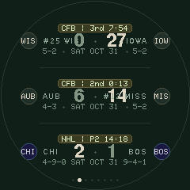

# NFL Score Tracker (ESP32-2424S012 Circular Display)

A live broadcast-style **NFL Score Tracker** designed for the **ESP32-2424S012** (1.28" 240x240 circular IPS GC9A01 display). It cycles through recent NFL scores from the last 7 days with team logos, detailed quarter-by-quarter line scores, top performers, and an animated 2-second circular progress ring.

<p align="center">
  
</p>

## Features
- **Last 7 Days of NFL Matchups:**
  - 15 games spanning Thursday Night Football, Friday International (São Paulo), Sunday Early/Late slates, Sunday Night Football, and Monday Night Football.
- **Official NFL Team Logos & NFL Shield:**
  - Full authentic high-resolution logos pulled directly for all 32 NFL teams plus the official NFL Shield emblem.
  - Rendered as 32x26 anti-aliased RGB565 bitmaps pre-composited with custom chroma-key transparency for clean edges on dark cards.
- **Television Broadcast-Grade Scorebug Layout:**
  - **Top Arc:** Official NFL Shield emblem, Day & Date (`THU SEP 17 - 1/15`), and game status pill badge (`FINAL` or `FINAL/OT`).
  - **Center Stage:** Dual matchup cards showing authentic team logo, team abbreviation, record, large bold scores, and winner gold chevron indicator.
  - **Line Score Box:** Quarter-by-quarter breakdown (`Q1`, `Q2`, `Q3`, `Q4`, `TOT`).
  - **Bottom Info:** Top player highlight (`★ Mahomes: 291 YDS, 2 TD`) and official stadium name (`GEHA Field at Arrowhead`).
  - **15-Dot Circular Pager:** Bottom dot navigation tracking the current active game index.
- **2-Second Auto-Tick & Immediate Button Navigation:**
  - **Animated Countdown Ring:** Glowing neon cyan arc sweeps clockwise around the perimeter of the circular display indicating the 2.0-second timer.
  - **Auto-Advance:** Automatically advances to the next matchup every 2 seconds.
  - **Physical Button Control (GPIO 9 BOOT Button):** Pressing the BOOT button immediately advances to the next game and resets the 2-second countdown timer.
- **USB Serial Control:**
  - Send `NEXT` over `/dev/ttyACM0` to advance to the next game.
  - Send `PREV` to go to the previous game.
  - Send `SET <idx>` (0..14) to jump directly to any game.
  - Send `PAUSE` / `RESUME` to freeze or unfreeze auto-advance.
  - Send `SCREENSHOT` to stream a 115,200-byte raw framebuffer over USB-CDC.

## Hardware Specifications
- **Board:** ESP32-2424S012 ("ESP32-C3+ round display without touch")
- **Chip:** ESP32-C3 (RISC-V single-core @ 160MHz, 4MB Flash)
- **Display:** 1.28" GC9A01 Circular IPS LCD (240x240, SPI @ 40MHz, LovyanGFX)
- **Controls:** BOOT button on GPIO 9 (active LOW)

## Building & Flashing
```bash
# Build firmware
uvx platformio run

# Flash to ESP32
uvx platformio run -t upload

# Capture live hardware screenshot over USB-CDC
python3 tools/capture_screenshot.py
```
