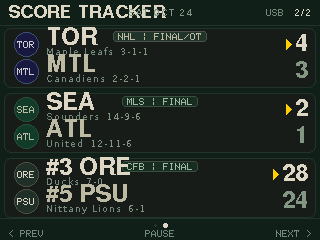

# NFL Score Tracker (ESP32-2432S028R "Cheap Yellow Display")

A live broadcast-style **NFL Score Tracker** for the **ESP32-2432S028R "Cheap
Yellow Display"** (CYD). It renders a landscape 320x240 touch UI that cycles
through recent NFL scores — team logos, quarter-by-quarter line scores, leaders,
and stadiums — with auto-advance, touch navigation, and a tap-to-open detail
overlay.

## Overview

- **Board:** ESP32-2432S028R "Cheap Yellow Display" (ESP32-D0WD-V3, dual-core
  240 MHz, 4MB flash).
- **Display:** 2.8" ILI9341 240x320 LCD driven over **HSPI**, configured into
  native **landscape 320x240**.
- **Touch:** XPT2046 resistive touch controller on a **separate VSPI bus**
  (polling, no IRQ).
- **Controls:** On-screen touch zones plus the physical **BOOT** button on
  GPIO 0 (active LOW) for page advance.
- **Rendering:** A single full-screen RGB565 `LGFX_Sprite` (320x240) is composed
  off-screen and pushed once per frame for flicker-free updates.
- **Data:** Runs standalone over Wi-Fi/ESPN, or accepts live score pushes over
  USB serial from a host laptop (same protocol as the round tracker).

<p align="center">
  
</p>

## Landscape Touch UX (320x240)

The interface mirrors the calm "zen" aesthetic of the round tracker, laid out
for a wide screen:

- **Header bar** — league/title plus current page and paused indicator.
- **3 game cards per page** — each card holds two team rows (logo, code, record,
  score) with the leader highlighted.
- **Footer** — pager dots and touch hints.
- **Touch zones:**
  - Bottom-**left** third → **PREV**
  - Bottom-**right** third → **NEXT**
  - Bottom-**center** → **PAUSE / RESUME**
  - Tap a **card** → open the **detail overlay** (quarter line scores, leader,
    stadium); tap anywhere in the overlay to return.

## Features

- **Auto-advance** — pages glide forward after `HOLD_DURATION_MS` (6s) using a
  `TRANSITION_DURATION_MS` (700ms) Hermite-eased slide.
- **Touch navigation** — debounced (`TOUCH_DEBOUNCE_MS` = 250ms) with a release
  required between taps; zone split set by `TOUCH_ZONE_FRACTION_PCT`.
- **Detail overlay** — per-game quarter-by-quarter breakdown, leader, and
  stadium; suspends auto-advance until dismissed.
- **Physical BOOT button** — GPIO 0 advances to the next page.
- **Serial keep-parity** — the round tracker's serial command protocol is
  preserved, so existing host tools and screenshot capture continue to work.
- **Live data & On-the-Fly Wi-Fi** — Standalone Wi-Fi polling with dynamic network management. Tap the header Wi-Fi indicator or long-press BOOT to open the network picker. Automatically probes open networks with live WAN validation, or enter passwords using the on-screen touch QWERTY keyboard. Credentials persist in NVS flash.
- **Multi-Sport Coverage** — NFL, College Football (NCAAF), Men's College Basketball (NCAAM), Women's College Basketball (NCAAW), MLB, WNBA, NHL, NBA, Premier League (EPL), UEFA Champions League (UCL), UEFA Europa League (UEL), La Liga, and Bundesliga with team logos, line scores, and sport-specific leader stats.
- **Fallback data** — bundled default games when offline.

## Pinout

| Function | Signal | GPIO | Bus |
|---|---|---|---|
| Display | SCLK / SCK | 14 | HSPI |
| Display | MOSI / SDI | 13 | HSPI |
| Display | MISO / SDO | 12 | HSPI |
| Display | DC / RS | 2 | HSPI |
| Display | CS | 15 | HSPI |
| Display | RST | -1 (tied to reset) | — |
| Backlight | BL (PWM) | 21 | — |
| Touch | SCLK / SCK | 25 | VSPI |
| Touch | MOSI / SDI | 32 | VSPI |
| Touch | MISO / SDO | 39 | VSPI |
| Touch | CS | 33 | VSPI |
| Touch | INT / IRQ | -1 (polling) | VSPI |
| Button | BOOT (active LOW) | 0 | — |

Serial / upload port: `/dev/ttyUSB0` (CH340) at 115200 baud.

## Building & Flashing

```bash
# Build firmware
uvx platformio run

# Flash to the CYD
uvx platformio run -t upload
```

## Serial Commands

Connect to `/dev/ttyUSB0` @ 115200 and send newline-terminated commands:

```
NEXT
PREV
SET <n>
PAUSE
RESUME
SCREENSHOT
SYNC_START
SCORES_START <n>
   ... per-line JSON ...
SCORES_END     (or ABORT to cancel)
SCORES_JSON <array>
WIFI OFF
WIFI ON
WIFI SETUP      (open the on-screen network picker)
WIFI SCAN       (scan available Wi-Fi access points)
WIFI AUTO       (auto-probe open Wi-Fi networks with live internet check)
WIFI CLEAR      (erase saved Wi-Fi credentials from NVS flash)
WIFI CONNECT <ssid> [pass]  (connect directly to SSID)
WIFI KEYBOARD <ssid>        (open on-screen keyboard for SSID)
TOUCH <x> <y>   (simulate a touch tap at landscape coords)
STATUS
REFRESH        (alias: SYNC)
TOUCHCAL
TOUCHDEBUG
```

## On-The-Fly Wi-Fi Management

You can configure Wi-Fi directly on the screen without recompiling or reflashing:

1. **How to enter Wi-Fi Setup:**
   - Tap the **`WiFi` / `NoWiFi` indicator** in the top header bar, or
   - Hold the physical **BOOT button (GPIO 0)** for > 1.5 seconds, or
   - Send `WIFI SETUP` over USB serial.
2. **Wi-Fi Network Picker:**
   - Displays all scanned 2.4 GHz SSIDs sorted by signal strength with signal bars and `LOCK` / `OPEN` badges.
   - Tap an open network to connect immediately.
   - Tap a protected network to open the **Touch QWERTY Keyboard**.
   - `[AUTO OPEN]`: Probes all detected open Wi-Fi networks in order, performs an HTTP head check (`site.api.espn.com:80`) to ensure real WAN access (bypassing captive portals), saves working credentials to NVS flash, and immediately begins streaming live scores.
   - `[RESCAN]`: Refreshes the local Wi-Fi scan.
   - `[DESK]`: Returns to the live scoreboard.
3. **On-Screen Touch QWERTY Keyboard:**
   - 5 rows: number row (`1-0`), `QWERTY`, home row `ASDFGHJKL`, `SHIFT`/caps toggle, `ZXCVBNM`, `DEL`, symbol row (`?123` / `#+=`), space bar, and `CONNECT`.
   - Live character length counter and `[SHOW] / [HIDE]` password mask toggle.
   - Validates connection upon submit and stores credentials in ESP32 NVS flash (`Preferences.h`).

- `SCREENSHOT` streams `320 * 240 * 2` raw RGB565 bytes of the **sprite**
  between `SCREENSHOT_START` and `SCREENSHOT_END` framing, matching the round
  tracker's capture tool.
- `SCORES_START <n>` begins a multi-line JSON score push; end it with
  `SCORES_END`, or discard it with `ABORT`.

## Touch Calibration

The XPT2046 raw bounds ship as compile-time defaults in
`src/LGFX_config.h` (`XPT_XMIN`, `XPT_XMAX`, `XPT_YMIN`, `XPT_YMAX`). If taps
land off-target:

1. Send `TOUCHCAL` over serial. The firmware streams raw touch coordinates.
2. Tap near each corner of the screen and note the min/max raw values seen for
   the X and Y axes.
3. Update `XPT_XMIN` / `XPT_XMAX` / `XPT_YMIN` / `XPT_YMAX` in
   `src/LGFX_config.h` and reflash.
4. Use `TOUCHDEBUG` at any time to stream decoded touch coordinates for
   verification.

## Factory Firmware

The CYD's factory firmware backup lives in the parent repo at
`../factory_backup_4MB.bin` (ESP32-CYD full 4MB image). Restore it any time with
`esptool` / `uvx esptool` as needed.
